# Tāne Sovereign OS Harness

> **In development: not yet ready to install.** Follow along, give feedback, or support the kaupapa (purpose).

A free, voice-first AI that you own. It lives on your phone and your own home computer, not in a big tech cloud. Tāne te Kaihanga (Tāne the Creator), its guide, was designed through a Māori lens, and it is free for everyone, everywhere.

**[See inside →](gallery/GALLERY.md)** — the screens, and what each one is for.

> **© Dr Thomas Clark. All rights reserved.** The images and designs here carry cultural knowledge and are my intellectual property. They are shown so you can see the vision, not to be copied or reused. See [COPYRIGHT](COPYRIGHT.md).

## Why Tāne

AI can be frightening, and it should be handled with care and respect. Who owns it, what it learns from, and where our words and knowledge end up all matter, especially for Indigenous peoples, whose knowledge has too often been taken without consent.

But AI can also be **augmented intelligence**: a tool that lifts people up rather than replacing them. In the right hands, and held under the right values, it can improve the quality of all our lives.

**Tāne te Kaihanga is a digital guardian.** He is built to:

- **protect our data**: it lives on your own phone and your own computer first, and nothing leaves without your say;
- **protect our knowledge**: mātauranga (knowledge) is kept and shared under tikanga (customs and protocols), never used to train anyone else's AI;
- **support people who have least**: the core of the harness is free. Intelligence like this, in the hands of families and communities who have been left out, can help them learn, grow their own skills, start their own work, and find a way out of poverty.

## See Tāne move

<table>
<tr>
<td>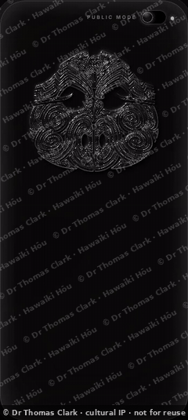 Tāne speaks, and the water moves with his words</td>
<td>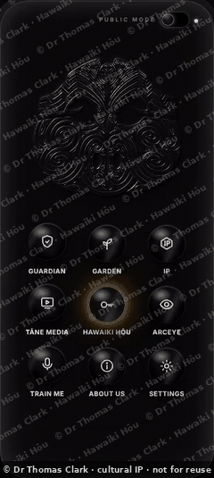 The nine doors, on living water</td>
<td>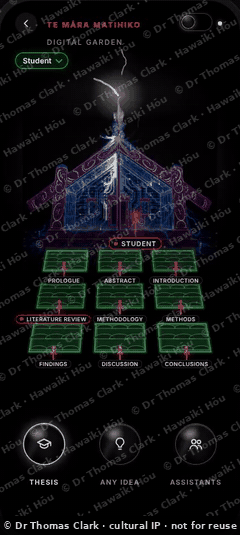 Te Māra Matihiko: lightning is Tāne at work</td>
<td>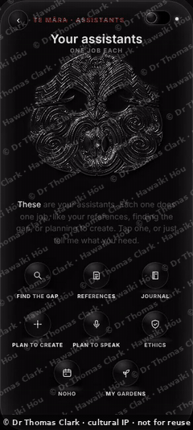 Assistants: one job each</td>
</tr>
<tr>
<td>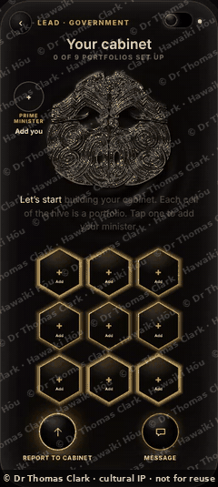 The cabinet, for government</td>
<td>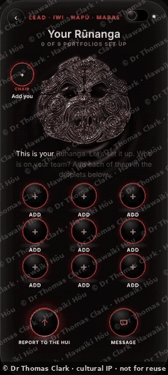 Te Rūnanga, for iwi, hapū and marae</td>
<td>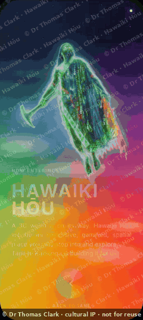 The doorway to Hawaiki Hōu</td>
<td>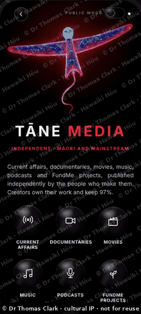 Tāne Media: creators keep 97%</td>
</tr>
</table>

Every screen is designed with the same care: clean, calm, nothing covering Tāne, room for every thumb. [See every screen, and what it's for →](gallery/GALLERY.md)

## What's inside the harness

Tāne is one guide, and around him are spaces built for real lives: learning, research, creating, connecting and resting.

### The Data Guardian: your data, kept under your own tikanga
Tāne te Kaihanga guards everything you keep. It is encrypted on your own phone first, and nothing leaves without your say. You choose a kete (basket) for each thing: the **Public Community Kete**, the **Indigenous Community Kete**, or **Te Kete Mātauranga** (the Basket of Māori Knowledge), for mātauranga Māori (Māori knowledge) held under tikanga. Sacred material is never sent to any cloud, and never used to train anyone else's AI.

### IP: protecting creative and cultural work
A place to register and protect what you make: art, designs, writing, research and the cultural knowledge within them. Creators set the terms for how their work may be used, and licences are made clear and fair, so Indigenous creators and researchers are credited, consulted and paid, instead of having their work taken.

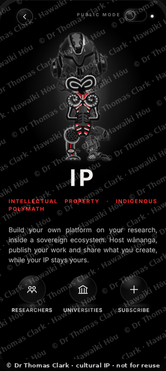 

### Train Me: Tāne learns you
Teach Tāne your own voice, your own way of speaking, your reo (the Māori language) and your words, on your own device. The more you use him, the better he understands you, and what he learns about you stays with you.

### Te Māra Matihiko: the digital garden, for education
A student grows their thesis or project as a garden. Each bed is a chapter, and Tāne helps it grow from the first idea to a finished, bound piece of work. Supervisors and teachers see their students' gardens and support them, and leaders see only what their people choose to send up. Universities, wānanga (places and gatherings of higher learning), schools and kura (Māori-language schools) can license it for their own students and staff.

### The researcher's page: social media for academics, owned by the researcher
A home for researchers that works like a social page but belongs to the person, not a platform. Publish theses and creative works, host wānanga, follow and review each other's work, and collaborate. Everything stays on your own device until you choose to share it, and your intellectual property stays yours.

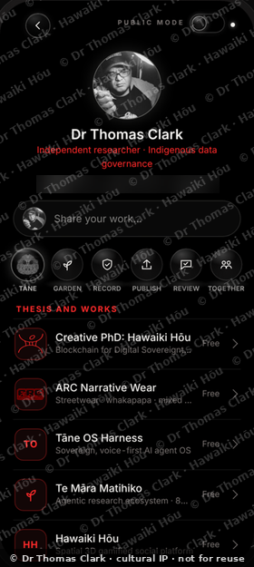

### Tāne Media's island and Hawaiki Hōu: spatial social media
Most social media is a page you scroll up and down, built to keep you scrolling. We are building something different: **social media as a place you go**. Instead of a feed, you arrive by waka (canoe) on Tāne Media's island, walk its paths, look up at Matariki (the Pleiades star cluster, whose rising marks the Māori New Year) and the stars, meet creators where they are, and play together, starting with **Kī-o-Rahi** (a traditional Māori ball game), our own ball game, on the island's field.

Hawaiki Hōu (New Hawaiki, our ancestral homeland reimagined) grows this into a shared world where everyone can hold their own piece of land, mountain and river, and creators keep 97% of what they earn.

It is designed around **digital health and homeostasis**: time online should have a natural rhythm, with a beginning, a middle and an end, like a visit, not an endless scroll. Tāne helps keep things in balance, so people leave feeling better than when they arrived. The island is in development.

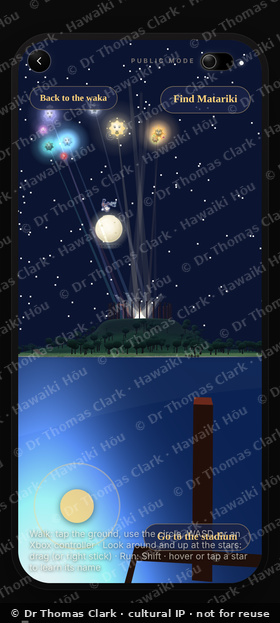 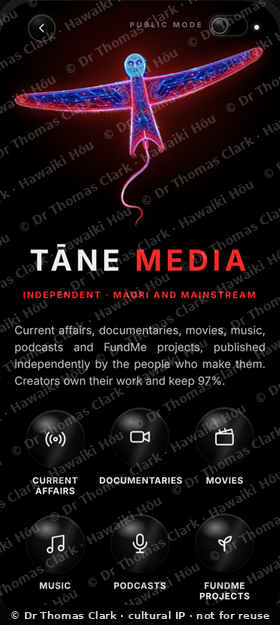

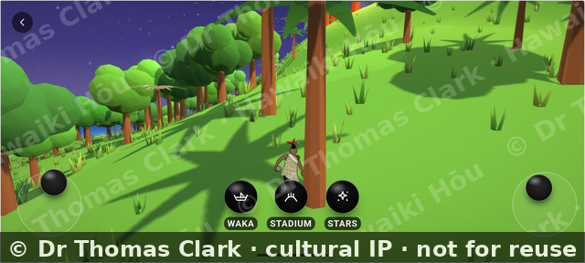

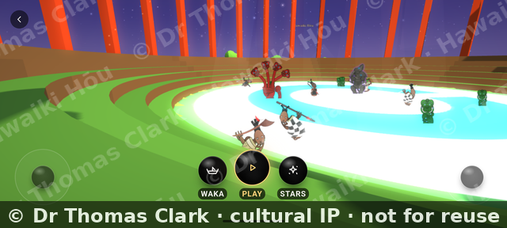

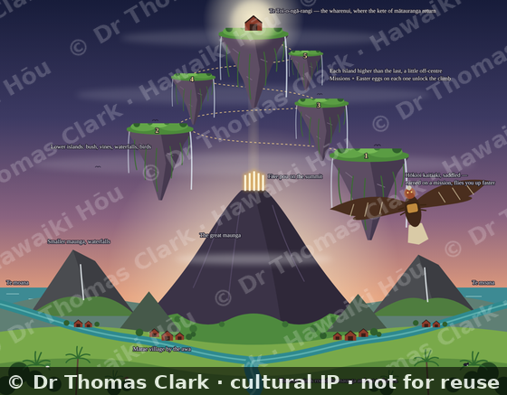

### ARCeye: art that comes alive
Point your phone's camera at an ARC print or ARC narrative wear and its story plays over it, from the phone itself, with no internet needed. Artists and creators can show their ARC works in the ARC Gallery.

## New since October

- **Wero (the ceremonial challenge: sizing up whoever approaches, to learn whether they come in peace with good intentions or as a threat), the guardian at the door.** Every word that tries to leave your device is checked first. Its rules are signed with a key kept inside your computer's own security chip, with recovery keys split across two drives kept in different places.
- **Your phone, away from home.** Tāne on your phone now reaches your own Home Node from anywhere, and finds it again by himself if its address changes.
- **No master key.** Nobody, not even us, holds a key that opens everyone's data. Shared decisions are guarded so a vote can never force a person's own node.
- **Cloud Mode (first steps).** For big builds like a website, only the empty shell goes to a cloud model. Your stories, whakapapa (genealogy), names and reo stay home, and Tāne explains what stays, what goes, and why, before anything leaves.
- **If the walls go up.** Tāne can keep open AI models from more than one country on your own drives, so he keeps thinking even if a service is cut off.
- **ARCeye.** Scan an ARC print with the phone and its film plays, with no internet.
- **Te reo in print.** Theses bound by Tāne keep every macron.
- **Coming:** Tāne Media's island, a world to explore with Kī-o-Rahi under the stars of Matariki, and **Tāne Hands**, using Tāne with your hands in the air.

## Who Tāne is for

- **Everyone, free:** the harness, Tāne, Train Me, Hawaiki Hōu and My Apps.
- **Education** *(subscription)*: Te Māra Matihiko (the Digital Garden), the digital garden, for universities, wānanga, schools and kura. Students grow their thesis or project as a garden, supervisors and teachers support them, and institutions get their own station.
- **Iwi (tribes), hapū (sub-tribes) and marae (community meeting grounds):** Te Rūnanga (the Council), to lead your people's work with their data kept under your own governance.
- **Companies and government:** the same harness for a chief executive and their teams, or a Prime Minister and their cabinet. Each leader sees only what their people sign and send up.

## Kia ora, and a thank you first

Before anything else, I want to acknowledge the developers, engineers and programmers who built the tools, languages and open-source projects the rest of us now stand on. You are the real heroes of this story.

I'm not a career programmer. I'm Dr Thomas Clark, a Māori artist and tā moko (the art of Māori tattooing) practitioner with a PhD, who had an idea. Because of your work, people like me can now build software by working alongside AI ("vibe coding"). My strengths are design and the user experience; yours made it possible.

## How Tāne is built, honestly

Tāne stands on the shoulders of open-source work and AI tools. We name them all:

| Part | What it does in Tāne |
|---|---|
| **Wero** | The guardian at the door. Decides what stays on your device and what (never anything tapu (sacred and restricted)) may use a cloud model. Its rules are signed with a key held in the computer's own security chip, so nobody can quietly change them. |
| **Herdr** | The orchestrator. Runs Tāne's jobs through his worker houses and reports progress back to your phone. |
| **Hermes 3** (via **Ollama**) | Tāne's local brain, running on your own computer. |
| **Voicebox** | Tāne's voice and ears: speech to text (Whisper) and text to speech (Kokoro), on your own machine. |
| **Obsidian** | Tāne's memory: plain notes you can read, change or delete yourself. |
| **SQLite** | Local storage on your devices. |
| **Hine** (DeepSeek) | Our build agent. Hine built the app and the backend, round by round, checking every screen on a real phone against the design. DeepSeek is also Tāne's optional cloud thinker, off by default and never used for anything tapu. |
| **Claude** (Anthropic) | Design, the prototype and every design review. |
| **React Native, Expo and Skia** | The phone app and its living water and graphics. |

Every design decision, the cultural direction and the purpose behind it are mine, Dr Thomas Clark. The full list of open-source projects, with thanks to the people who made them, is in [ACKNOWLEDGEMENTS](ACKNOWLEDGEMENTS.md).

## Agentic AI for everyone

We believe agentic AI should be within everyone's reach, not just big companies. That's why the core of the harness is free for anyone, anywhere: so people can get ahead, learn, build and improve it themselves.

## Money goes back to the people

Most platforms let money flow up from the people to the top 1%. Ours is built the other way: money flows from the top down to the people who use it. People benefit from their own data and content, instead of big tech profiting from it. Creators keep 97% of what they earn, and the rest is reinvested for the users' benefit. The whitepaper explains the full model.

## Our promises

- Your data stays on your phone or your own home computer.
- Nothing leaves without your permission.
- Your words, voice and knowledge are never used to train anyone else's AI.
- It works offline.
- Private and sacred conversations never leave your device.

## Check it yourself

Our promises should be checked, not just believed. We are building automatic tests for each promise, which will run every time the code changes once the engine's code is published:

- **No hidden internet calls:** fails if the app contacts anything except your own devices.
- **Encryption:** your data is locked before it is stored or sent.
- **Same code, same app:** anyone can rebuild the app from this code and get exactly the app in the store.

Until then, the [roadmap](ROADMAP.md) shows where each one is up to.

## Where your data goes

Your phone → your home computer. That is the whole map for most people. Only if you choose to, for extra space or a backup in case a device breaks, secure storage with Te Pā Tūwatawata (named for a pā tūwatawata, a fortified place of strength and security that defends and provides for those within: an iwi-designed, Māori-owned data storage network built with Māori data sovereignty at the forefront, developed by Te Kāhui Raraunga), encrypted so even they cannot read it. Big tech is not on the map.

## Free and paid

- **Free for everyone:** the Harness, the Tāne Dashboard, Train Me, Hawaiki Hōu and My Apps.
- **Subscriptions:** Te Māra Matihiko (for researchers), the Data Guardian features, IP protection and Tāne Media (creators keep 97%).
- **Extra secure storage, only if you need it (planned):** your data lives on your own phone and computer. Te Pā Tūwatawata is an extra, safe place for two things: **more space** if you run out on your own devices, and **a backup**, so if a phone or computer breaks or you buy a new one, your data is waiting to come home to it. It is encrypted so even they cannot read it, and its principles align with Māori data sovereignty. We aim to offer it once an agreement is in place, with a small amount free.

## What you'll find here

- [Whitepaper](WHITEPAPER.md): why Tāne exists
- [Blueprint](BLUEPRINT.md): how Tāne is made, what parts we used and why
- [Our values](VALUES.md)
- [Roadmap](ROADMAP.md)
- [Gallery](gallery/GALLERY.md): a look inside, screen by screen
- [Community](COMMUNITY.md): how to talk with us
- [Copyright and cultural IP](COPYRIGHT.md): the images and designs carry cultural knowledge and are not for reuse
- [Research and publications](research/): my papers, including "Hawaiki Hōu: Artificial Intelligence or Augmented Intelligence?", and my PhD

If you're a developer, I would be honoured to learn from you. Come and review the code, question our choices, and help make this better.

## Support this project

Tāne Sovereign OS Harness is self-funded: a personal postdoctoral passion project, built in my own time. Any donation helps pay for the tools it takes to build it (AI services, APIs and software subscriptions), so the harness can stay free for everyone. You can support it through the Sponsor button at the top of this page, and I'll share openly how the money is spent.

### Support the kaupapa

Tāne is built for Māori data sovereignty and mana motuhake (self-determination): a harness that runs on your own phone and your own Home Node first, with nothing leaving without your say. There are two ways to help.

#### Give
Sponsorship is being set up and will open soon. When it does, every koha (a gift or donation) goes into building and testing Tāne: the local AI on the Home Node, the te reo voice, and Hawaiki Hōu.

#### Help us test it
We especially want people to **check the harness**:

- **Reliability:** does it work every time, on real phones, offline?
- **Safety:** does Tāne always ask before acting, never correct the person, and protect tamariki (children)?
- **Security:** can anything leave the device that shouldn't, or be read by someone who shouldn't?
- **Robustness:** what happens with bad input, a lost connection, a full disk, or a hostile link?

Start with [CONTRIBUTING.md](CONTRIBUTING.md). If you find a security problem, **don't open a public issue**: follow [SECURITY.md](SECURITY.md).
