# A look inside Tāne

These screens come from the **Tāne Core Flow prototype**, the design that every part of the app is built to match. Tāne is a sovereign, voice-first harness: one guide who lives on your own phone and your own Home Node, speaks with you, and does the work you ask, **local first, with nothing leaving without your say**.

Every screen below starts empty and ready for a first-time user. There are no sample people or made-up data.

> **Cultural note.** Tāne's face (the mataora (a man's full facial moko (traditional Māori tattoo))), Tāne te Kaihanga (Tāne the Creator), the moko, the wharenui (meeting house) and its carvings, the manu aute (a traditional Māori kite), the hōkioi (the extinct Haast's eagle) and the IP figure are the creative work and intellectual property of Dr Thomas Clark. **Cultural knowledge is embedded within these designs.** They appear here, small and watermarked, so people can understand the vision. They are **not** covered by any code licence and may not be copied, traced, adapted, used to train AI or reused in any way. © Dr Thomas Clark. All rights reserved. See [COPYRIGHT](../COPYRIGHT.md).

---

## 1. Tāne: the nine

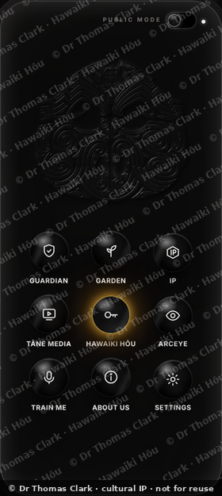

The home of the harness. Tāne's face lives in moving black water, and the water ripples when he speaks or when you touch it. Below him are nine doors to the whole system. You can tap them or simply say where you want to go. One switch at the top chooses **Public** (Tāne speaks and answers to his name) or **Private** (everything stays on the phone, text only).

---

## 2. Te Māra Matihiko: the digital garden

### The student's garden

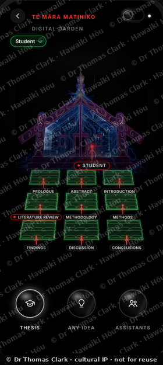

A thesis is a garden. The nine beds are the nine chapters, from Prologue to Conclusions, and they grow as the student writes. The wharenui holds the work together, and the lightning is Tāne at work. There are only three buttons: **Thesis**, **Any idea** (the same garden for any project, not only a thesis) and **Assistants**.

### Assistants

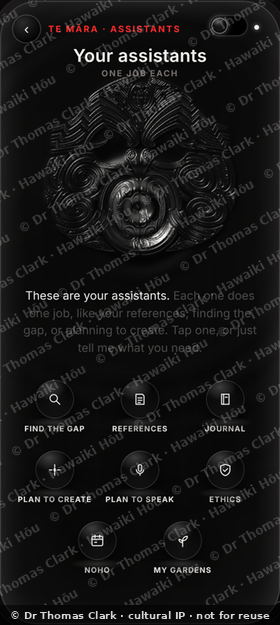

Each assistant does one job: finding the gap in the literature, keeping every reference real, journalling, planning a creative work or a talk, ethics and consent, and noho (stay). Tāne explains first, and the person decides.

### The supervisor's garden

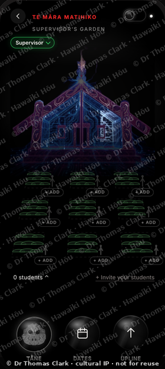

A supervisor adds their students, and each student joins by accepting their own signed invite. Then the supervisor and student see the same garden. The supervisor sees how it grows, never the student's drafts or anything tapu (sacred and restricted). Students under one supervisor form a cohort and can share with each other.

### Dates and noho

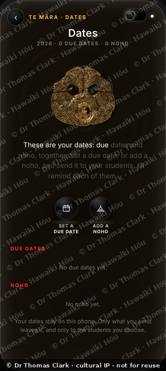

Due dates and noho on one calm page. Each student agrees to a date on their own phone, or suggests another one, and Tāne reminds them as it comes up.

---

## 3. Leaders: the same harness, in your world

### The cabinet

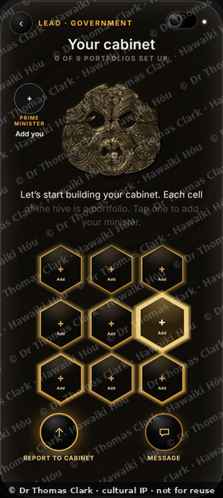

A Prime Minister builds a cabinet. Each cell of the hive is a portfolio, and each minister holds one. The leader only sees what each minister signs and sends up, so nobody's working notes are exposed. The water turns honey-gold here.

### Te Rūnanga

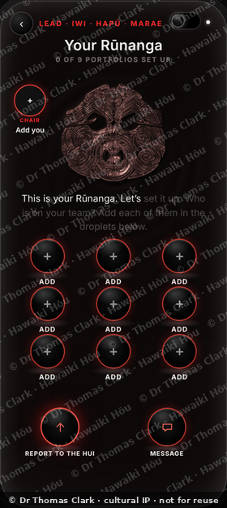

For an iwi (tribes), hapū (sub-tribes) or marae (community meeting grounds), the water and Tāne turn kōkōwai (red ochre) red. The Chair adds their team, and Tāne arranges them evenly, however many there are. The same pattern serves a company: a chief executive and their teams.

### A minister's own portfolio

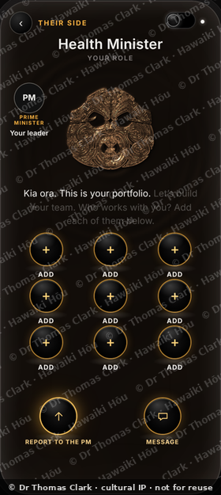

Everyone has their own view. A minister sees their leader, their own portfolio and their own team, and builds from there, reporting up only what they choose to sign.

---

## 4. IP: Intellectual Property · Indigenous Polymath

### Build your own platform

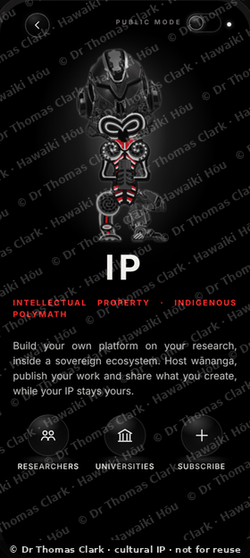

A sovereign home for research. Researchers build their own platform, host wānanga (places and gatherings of higher learning), publish their work and share what they create, while their intellectual property stays theirs.

### A researcher's page

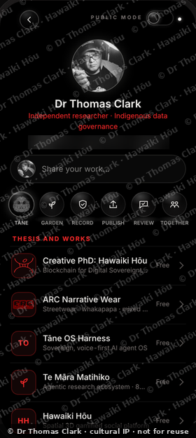

Like a social media page, but owned by the researcher. Posts, works and connections stay on their own device until they choose to share. Researchers publish their theses and creative works, follow each other, review, and work together. Universities and wānanga license a station for their own students and staff.

### Institution licence

Universities, wānanga, schools and kura (Māori-language schools) set up their own station: a garden for every supervisor or teacher, and a page for every student, with whānau (family) consent built in for schools.

---

## 5. Tāne Media

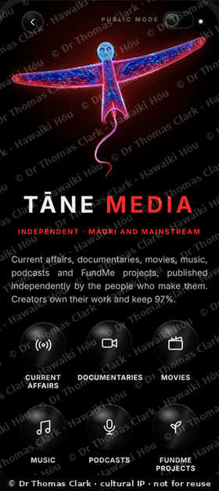

Independent media, Māori and mainstream: current affairs, documentaries, movies, music, podcasts and FundMe projects, published by the people who make them. **Creators own their work and keep 97%.** The manu aute (the traditional kite) carries the stories.

### Where Tāne Media is going: a journey up the awa

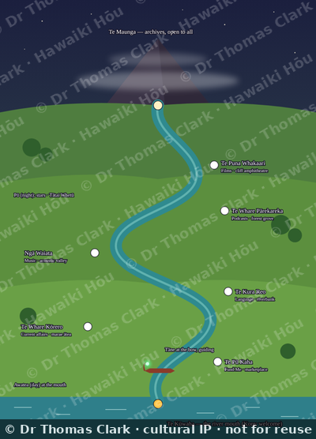

*Concept sketch, a layout only. The finished world will be fully painted and alive.*

Tāne Media is becoming a **spatial world**, part of Hawaiki Hōu (New Hawaiki, our ancestral homeland reimagined), instead of a flat grid of thumbnails. You travel in a waka (canoe) up an awa (river), with Tāne at the bow as your kaitiaki. Each kind of media is a place on the riverbank:

| Place | What it holds |
|---|---|
| **Te Kūwaha**, the river mouth | A warm, bilingual welcome for newcomers |
| **Te Pū Kaha**, a marketplace by the gates | FundMe projects and creator support |
| **Te Whare Kōrero**, a marae ātea ringed by pou (carved posts) | Current affairs, live broadcasts, community updates |
| **Te Kura Reo**, a sunlit riverbank | Te reo (the Māori language) games and speaking practice with Tāne |
| **Ngā Waiata**, an acoustic valley | Music, live sessions, soundscapes |
| **Te Whare Pārekareka**, a forest grove | Podcasts and oral histories |
| **Te Puna Whakaari**, an amphitheatre in the cliffs | Films and documentaries |
| **Te Maunga**, the misty peak | Archives, open to everyone |

- **Look, point or speak to steer:** where you look, Tāne notices and offers to take you there. Looking is opt-in and never recorded. Tapping and voice always work too.
- **Awatea and Pō:** bright day for exploring, live kōrero and watching together; a starry night of Tātai Whetū for documentaries, archives and rest.
- **Play while you learn:** Easter eggs along the awa, and saying words in te reo opens gates and hidden landing places. Tāne never corrects you harshly.
- **Safe for tamariki (children):** a whānau-controlled mode with no strangers, no ads, no purchases and no streaks, and a child's voice is never kept.
- **Stages:** a 2.5D awa on the phone first, then full 3D on desktop, then headsets.

---

## 6. Hawaiki Hōu

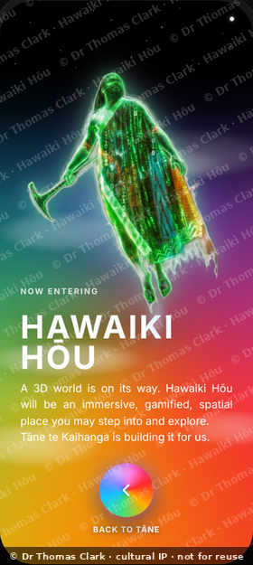

**Hawaiki Hōu is the world we are building next**: an immersive, gamified, spatial 3D place you can step into and explore, led by Tāne te Kaihanga.

- **The journey in:** you arrive by waka through the code of Te Pō, with Tāne at the bow, and cross into a living world at dawn.
- **The land:** a great maunga (mountain) with five pou on its summit, smaller maunga each with their own marae beside the awa, and an awa that winds through the whole land and out to the sea.
- **The climb:** floating islands rise one above another into the heavens. Each island holds missions and Easter eggs that open the way to the next. It is a cleansing journey, so that by the top you are ready to enter the sacred realm with respect.
- **The top:** Te Toi-o-ngā-rangi, where the wharenui stands and the kete (basket) of mātauranga (knowledge) are returned.
- **The kaitiaki:** a saddled hōkioi (Haast's eagle) that can be earned on a mission and carries you higher, faster.

### The world we are building

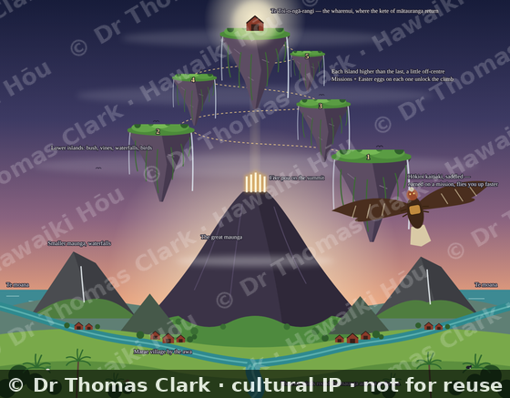

*Concept sketch, a layout only. The finished world will be thick with bush, wildlife, texture and light.*

**Its purpose.** Hawaiki Hōu is a place to carry our knowledge home. The story of Tāne climbing to the uppermost heaven to bring back the three kete of knowledge is the heart of it. Here, a whole community makes that climb together and returns mātauranga to where it belongs. It is a game people want to play, a place to learn te reo and tikanga (customs and protocols) by doing, and a living home for the work, stories and media of the people in it, owned by them and governed by tikanga.

- **Your own place:** every person and whānau has their own small maunga and marae by the awa.
- **One awa joins everything:** the awa runs through the whole land, around the great maunga and out to the sea. Tāne Media's journey is one stretch of it.
- **The climb is the learning:** each island's missions build skill, reo and understanding, so the sacred realm is reached with respect, never by rushing or buying your way.

Taonga species and sacred knowledge are treated with care and guided by knowledge-holders.

---

## 7. The Data Guardian

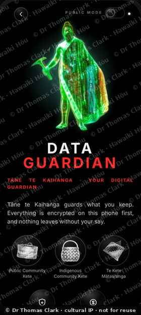

Tāne te Kaihanga guards what you keep. Everything is encrypted on your own phone first, and nothing leaves without your say. You choose a kete for each thing you keep: the **Public Community Kete**, the **Indigenous Community Kete**, or **Te Kete Mātauranga** (the Basket of Māori Knowledge) for mātauranga Māori (Māori knowledge) held under tikanga.

---

## The design rules behind every screen

- Clean, not clunky: one clear action per screen, and round drops instead of boxes.
- Nothing ever covers Tāne.
- Every button has room for any thumb, with never more than three at the foot.
- White means Tāne is talking, red means he is working, and gold means complete.
- Local first: Ollama, SQLite and your own Home Node before any cloud.
- **Māori data sovereignty and mana motuhake (self-determination), always.**

---

## Tāne Media's island: social media as a place

Not a feed to scroll, but a place to visit. You arrive by waka, walk the island, look up at Matariki (the Pleiades star cluster, whose rising marks the Māori New Year), meet creators, and play Kī-o-Rahi (a traditional Māori ball game) together on the field. Designed for digital health and homeostasis: a visit with a natural rhythm, not an endless scroll. *In development.*

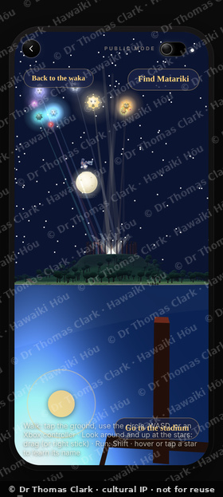

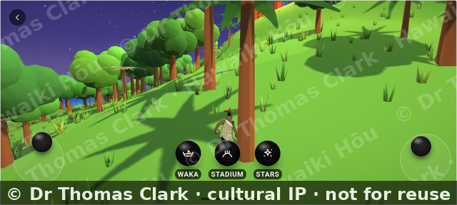

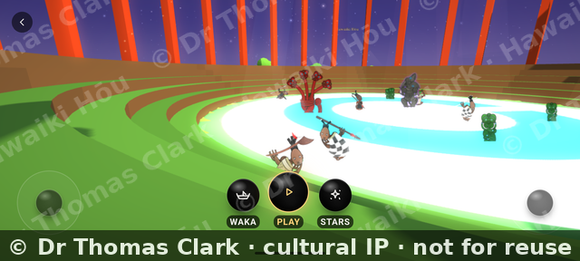

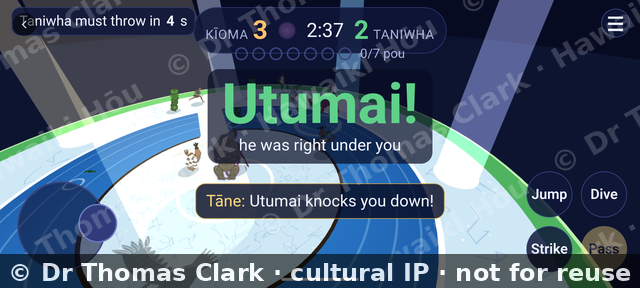

---

## Leaders: anyone who leads

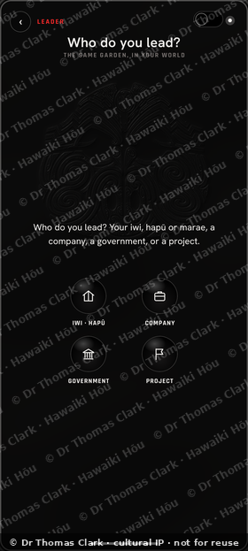

The same garden, in your world. An iwi (tribe) or hapū (sub-tribe) leader adds themselves as chair and their board in the droplets; a chief executive their teams; a Prime Minister their cabinet; a project lead the parts of their project. Each leader sees only what their people choose to send up.

## Cloud Mode: the shell goes out, the knowledge stays home

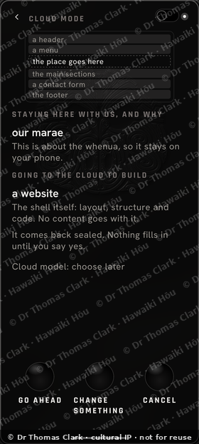

For a big build like a website, only the empty shell (layout and code) may go to a cloud model. The knowledge, such as our marae (community meeting grounds), pūrākau (ancestral stories) and whakapapa (genealogy), stays home, and Tāne explains what stays, what goes, and why, before anything leaves. You choose: Go ahead, Change something, or Cancel. *First steps built; practice runs only.*

